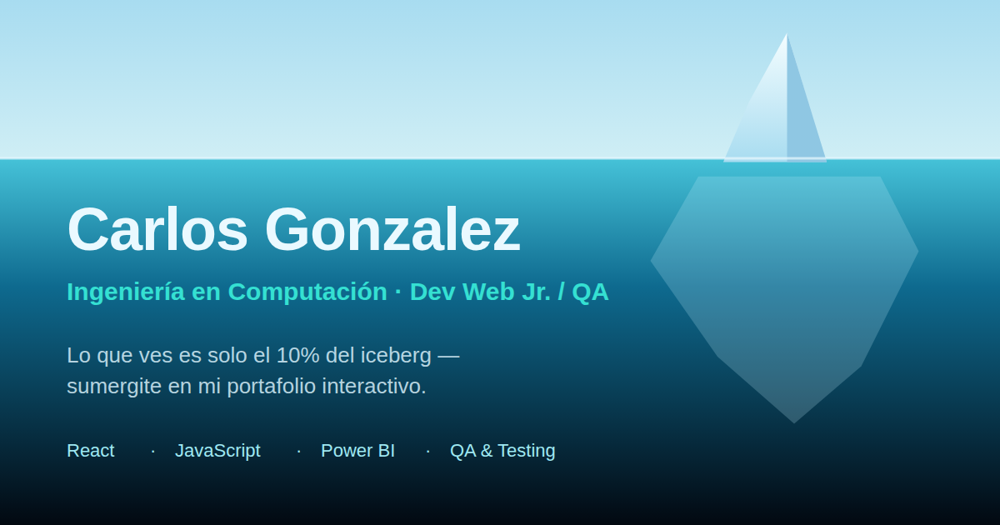

# Carlos Gonzalez — Portafolio "El 90% bajo el agua"

Portafolio web interactivo con la metáfora de un **iceberg**: solo el 10% se ve
desde la superficie, y a medida que hacés scroll te sumergís en un océano
animado que revela distintas capas de mi perfil profesional.

🌐 **Sitio en vivo:** https://carlos1290.github.io/portafolio/



---

## Índice

- [Stack tecnológico](#stack-tecnológico)
- [Cómo funciona la experiencia](#cómo-funciona-la-experiencia)
- [Estructura del proyecto](#estructura-del-proyecto)
- [Las zonas de profundidad](#las-zonas-de-profundidad)
- [La pasarela de proyectos](#la-pasarela-de-proyectos)
- [Contacto](#contacto)
- [Internacionalización (ES/EN)](#internacionalización-esen)
- [SEO y metadatos](#seo-y-metadatos)
- [Seguridad (CSP) y privacidad](#seguridad-csp-y-privacidad)
- [Accesibilidad](#accesibilidad)
- [Rendimiento](#rendimiento)
- [Calidad: lint, tests y Lighthouse CI](#calidad-lint-tests-y-lighthouse-ci)
- [Desarrollo local](#desarrollo-local)
- [Despliegue continuo con GitHub Pages](#despliegue-continuo-con-github-pages)
- [Personalización](#personalización)

---

## Stack tecnológico

| Capa               | Tecnología                                                             |
| ------------------ | ---------------------------------------------------------------------- |
| Framework          | React 18                                                               |
| Build / dev server | Vite 5                                                                 |
| Estilos            | CSS3 puro (custom properties, sin frameworks)                          |
| Fuentes            | Self-hosted woff2 (Unbounded, Sora, IBM Plex Mono — subconjunto latin) |
| Animaciones        | CSS keyframes + scroll-driven variables (cero librerías de animación)  |
| Iconografía        | Set SVG propio y uniforme (`Icons.jsx`, stroke `currentColor`)         |
| Tests              | Vitest + React Testing Library (unitarios) · Playwright (e2e)          |
| Calidad            | ESLint (react, react-hooks, jsx-a11y) + Prettier + Husky pre-commit    |
| CI/CD              | GitHub Actions → GitHub Pages, con gate de Lighthouse CI               |

**Sin dependencias de runtime además de React.**

## Cómo funciona la experiencia

El corazón es una única variable CSS — `--p` (progreso de scroll de `0` a `1`)
— alimentada por un listener de scroll con `requestAnimationFrame`
(`src/hooks/useScrollDepth.js`). Todo lo demás se deriva de ella por CSS:

```
scroll ──▶ rAF ──▶ documentElement.style.setProperty('--p', 0..1)
                        │
        ┌───────────────┼──────────────────┬─────────────────┐
        ▼               ▼                  ▼                 ▼
  Iceberg SVG      Línea de agua      Degradado del      Opacidad de
  (se hunde)       (sube y sale)      océano (oscurece)  rayos/burbujas
```

- **`<Ocean />`**: escena fija (`position: fixed`, `z-index: -1`) detrás del
  contenido: cielo, agua con degradado de profundidad, olas SVG, rayos de luz,
  16 burbujas y 24 partículas bioluminiscentes. El iceberg es un SVG con dos
  masas: la punta visible (10%) y la sumergida (90%).
- **`<DepthGauge />`**: HUD estilo sonar (0 → −900 m) con la zona actual y
  barra de inmersión; se actualiza por DOM directo desde el rAF, sin re-renders.
- **Reveals**: `useReveal()` (IntersectionObserver) agrega `.is-visible` a los
  `[data-reveal]` con fade + slide-up escalonado.
- **Fallback sin JS**: el Hero está prerenderizado dentro de `#root` y hay un
  bloque `<noscript>` con el resumen completo del perfil; los estados ocultos
  de `[data-reveal]` solo aplican con la clase `.js` activa.

## Estructura del proyecto

```
├── .github/workflows/deploy.yml         # CI/CD → GitHub Pages + gate LHCI
├── .husky/pre-commit                    # lint-staged antes de cada commit
├── .lighthouserc.json                   # umbrales perf ≥80 · a11y ≥85
├── eslint.config.js / .prettierrc       # calidad de código
├── index.html                           # SEO/OG/Twitter/canonical/CSP/JSON-LD + prerender
├── vite.config.js                       # base: '/portafolio/'
├── public/
│   ├── cv-carlos-gonzalez.pdf           # CV descargable
│   ├── favicon.svg / favicon-32.png / apple-touch-icon.png
│   ├── og-image.svg / og-image.png      # imagen social 1200×630
│   ├── robots.txt / sitemap.xml / 404.html
│   └── img/mock-*.svg                   # capturas de la pasarela
├── src/
│   ├── main.jsx / App.jsx               # clase .js + I18nProvider + hooks de scroll
│   ├── index.css                        # tema completo
│   ├── assets/fonts/                    # woff2 latin self-hosted
│   ├── data/
│   │   ├── projects.json                # fichas de la pasarela (ES + campos _en)
│   │   └── i18n.json                    # diccionario ES/EN de toda la UI
│   ├── hooks/
│   │   ├── useScrollDepth.js            # --p, HUD, zonas, pausa de escena, reveals
│   │   ├── useScrollDepth.test.jsx      # unitarios (Vitest + RTL)
│   │   └── useI18n.jsx                  # provider de idioma con persistencia
│   └── components/                      # Ocean, DepthGauge, secciones, galería, Icons
└── e2e/critical-path.spec.js            # Playwright: ruta crítica completa
```

## Las zonas de profundidad

| Zona               | Profundidad | Sección  | Contenido                               |
| ------------------ | ----------- | -------- | --------------------------------------- |
| Superficie         | 0 m         | Hero     | Presentación + descarga de CV           |
| Zona iluminada     | −040 m      | Bitácora | Sobre mí + educación (UDELAR, ÁNMA TEC) |
| Zona crepuscular   | −180 m      | Arsenal  | Competencias + formaciones              |
| Zona de penumbra   | −280 m      | Pasarela | Carrusel de proyectos                   |
| Zona de medianoche | −450 m      | Misión   | Equipos Consultores (BI, QA, geo)       |
| El abismo          | −900 m      | Contacto | Contacto + referencia profesional       |

## La pasarela de proyectos

- **Autoplay en bucle** (3,5 s por ficha, `AUTOPLAY_MS`) con transición suave.
- **Navegación por flechas ‹/›** y puntos indicadores (botones accesibles con
  `aria-label`/`aria-current`); sin scrollbar ni arrastre manual.
- **Pausa automática**: hover, foco de teclado, pestaña oculta y
  `prefers-reduced-motion`.
- **Modal de ficha completa**: `role="dialog"`, **focus trap** (Tab/Shift+Tab
  ciclan dentro), cierre con Escape/backdrop/botón y **devolución del foco** al
  activador (WCAG 2.4.3). Muestra resumen, arquitectura, métricas y enlaces.
- **Capturas**: mockups SVG propios en `public/img/` referenciados desde
  `projects.json` (`captura_o_demo`); aceptan imágenes reales sin tocar código.

## Contacto

- Una sola etiqueta con el mail: al hacer clic **copia el correo** (Clipboard
  API, con toast `role="status"`) y **abre Gmail web** en otra pestaña — sin
  app nativa y sin botones separados.
- El formulario compone el mail en Gmail con asunto y cuerpo prellenados.

## Internacionalización (ES/EN)

- Conmutador 🌐 en la barra de navegación; diccionario completo en
  `src/data/i18n.json` (incluye nombres de zonas del HUD).
- Los proyectos se traducen con campos `*_en` en `projects.json`.
- La preferencia se persiste en `localStorage` y sincroniza `<html lang>`.

## SEO y metadatos

- Meta description, author, theme-color y `canonical`.
- Open Graph (`og:title/description/image/url/locale`) con imagen 1200×630 y
  Twitter Card `summary_large_image`.
- JSON-LD `schema.org/Person` (educación, skills, `sameAs` LinkedIn).
- `robots.txt`, `sitemap.xml` y `404.html` personalizada.
- Pendiente manual: dar de alta la URL en Google Search Console y enviar el
  sitemap.

## Seguridad (CSP) y privacidad

- Meta `Content-Security-Policy` estricta: `default-src 'self'`, sin
  `connect-src`, sin third-parties (las fuentes son locales).
- Email y teléfono se ensamblan en tiempo de ejecución en `Contact.jsx`; el
  HTML fuente y el JSON-LD no contienen la PII completa en texto plano.

## Accesibilidad

- WCAG 2.2 AA: foco visible, focus trap en modal con restauración de foco,
  piso de fuente 0.75rem (zoom 200 %), HTML semántico, labels reales,
  `aria-live` en el toast, iconos SVG `aria-hidden` junto a texto visible.
- `prefers-reduced-motion` desactiva olas, rayos, burbujas, autoplay y
  animaciones del modal.

## Rendimiento

- ~58 kB JS gzip + ~6 kB CSS gzip, cero librerías de animación/UI.
- Fuentes woff2 subconjunto latin auto-hospedadas (`font-display: swap`).
- `content-visibility: auto` por sección y pausa total de animaciones de la
  escena cuando la pestaña está oculta (`IntersectionObserver` +
  `visibilitychange`).
- `backdrop-filter` reducido a 8 px en pantallas ≤768 px; HUD oculto en
  pantallas de altura ≤720 px.

## Calidad: lint, tests y Lighthouse CI

```bash
npm run lint          # ESLint con react, react-hooks y jsx-a11y
npm run format        # Prettier
npm test              # Vitest: 8 unitarios (zonas, HUD, scroll)
npm run test:e2e      # Playwright: 6 flujos de la ruta crítica
```

- **Pre-commit**: Husky + lint-staged (eslint --fix + prettier sobre lo
  stageado).
- **Lighthouse CI** corre en cada deploy; el pipeline **falla** si
  Performance < 80 o Accessibility < 85.

## Desarrollo local

```bash
git clone https://github.com/carlos1290/portafolio.git
cd portafolio
npm install
npm run dev        # http://localhost:5173/portafolio/
npm run build      # genera dist/ (no se versiona: lo produce la CI)
npm run preview    # sirve el build en http://localhost:4173/portafolio/
```

Requiere Node ≥ 20 (ver `engines`).

## Despliegue continuo con GitHub Pages

`.github/workflows/deploy.yml` se ejecuta en **cada push a `main`** (y
manualmente con `workflow_dispatch`):

1. `npm ci` + `npm run build` (Node 20, caché de npm)
2. **Lighthouse CI** — gate de calidad sobre el build servido en preview
3. `actions/configure-pages@v5` con `enablement: true` (crea el sitio si no existe)
4. `actions/upload-pages-artifact@v3` publica `dist/`
5. `actions/deploy-pages@v4` despliega

Flujo de ramas: el desarrollo se acumula en **`develop`**; el deploy ocurre al
fusionar a **`main`**.

## Personalización

| Quiero cambiar…            | Editar                                               |
| -------------------------- | ---------------------------------------------------- |
| Un proyecto de la pasarela | `src/data/projects.json` (ES y sus `_en`)            |
| Una captura real           | `captura_o_demo` → archivo en `public/img/`          |
| Textos de la interfaz      | `src/data/i18n.json` (es y en)                       |
| Colores / tipografías      | Bloque `:root` de `src/index.css`                    |
| Idioma por defecto         | `I18nProvider` en `src/hooks/useI18n.jsx`            |
| Velocidad del autoplay     | `AUTOPLAY_MS` en `src/components/Projects.jsx`       |
| Profundidad de cada zona   | `zone-marker` de cada sección + escala `p * 900`     |
| Mis datos de contacto      | Constantes al inicio de `src/components/Contact.jsx` |
| Umbrales de Lighthouse     | `.lighthouserc.json`                                 |

---

© 2026 Carlos Gonzalez — Montevideo, Uruguay.
